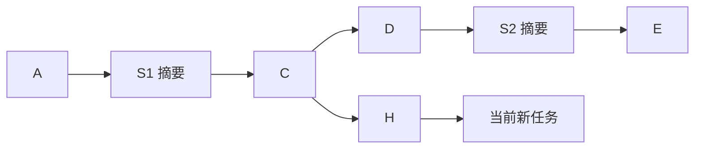

# 祖先任务记忆召回

## 用途与参考边界

探索问答运行时提供 `search_memory` 与 `view_memory_query`，找回当前有效历史范围内、尚未完整注入上下文的原始任务。Core 保留通用工具、子 Agent、分页与历史渲染，树范围及 MySQL 读取由宿主注入。

沿用 contract-service-be 已验证的组织方式：六个条件工具驱动的多轮检索子 Agent，用户输入/中途输出/最终结论三个字段分别走关键词和向量召回，使用 LlamaIndex `QueryFusionRetriever(mode='reciprocal_rerank', num_queries=1)` 融合，再通过查询标识分开读取页面。没有新增 LLM 查询扩写或自写 RRF 算法。

| 参考实现 | 本项目适配 |
| --- | --- |
| 同会话历史任务 | 本人当前树中，正在执行任务的严格祖先任务。 |
| SQLite FTS5/Lindera BM25 | 已有 MySQL ngram `MATCH ... AGAINST` 自然语言模式；不宣称分数等同 BM25。 |
| SQLite vec 精确余弦 | 已有 MyVector 编码与 `myvector_distance(...,'Cosine')`，在限定范围内精确排名。 |
| 每任务每字段一份投影 | 本项目每消息一份向量，单路先按任务取最佳消息分数，再 Top-20，避免长任务重复占位。 |
| 会话结果池 | 当前正在执行任务的独立结果池，结束即释放，防止查询标识被另一分支复用。 |
| 参考任务终态 | 本项目 `complete/cancelled/superseded/failed`，不加入未实现终态。 |

使用已有权威表与索引缓存，无新依赖包、表或 HTTP 接口。MyVector 和全文索引须由部署预先准备；本轮不修改实际配置、真实数据库及其他项目。

---

## 祖先范围

身份、树 ID 与当前任务 ID 来自已认证宿主，不是工具参数。`QuestionTreeSnapshot.ancestor_tasks` 从当前任务的父节点走到树根，遍历采用迭代方式；摘要节点允许经过但不成为候选，也不会像常规上下文加载一样截断回溯。

上例当前任务的候选为 A、C、H；D、E 不在其父链中，S1、S2 是摘要，也不返回。若用户选择 D 开始新任务，则 D 是新任务的祖先，候选包含 A、C、D；即使 D 后面已有 S2 和 E，也不读取它们。当前正在生成的任务自身不参与召回。

这里的祖先限制是硬边界；时间、终态条件只在这个集合里进一步收窄，不能扩大到整树、兄弟分支、后代、其他树或用户。权限和归属在读取结构、发布缓存和翻页回读时重新检查。

常规上下文仍只加载最近摘要及之后的有效路径，规则不变；记忆工具用于主动找回更早原文，不自动把全部祖先注入每次模型请求。

---

## 检索与融合

1. 主助手调用 `search_memory(query)`，检索子 Agent 根据自然语言需求设置条件；参考时间使用当前任务真实创建时间。
2. 初始不限时间/终态，三个字段均未开启。六个工具分别设置时间、终态、用户输入、中途输出、最终结论，以及最终执行；至少启用一个字段。
3. 仓库确认用户归属并构建父链，按任务创建时间和终态筛选。自然日按北京时间解释；范围包含下界、不含上界，业务正文提到的日期不自动作为创建时间过滤。
4. 只对有成功向量和可解析完整原文的字段进行召回。查询向量复用[基础编码指令](../../../capability/application/memory-embedding.md#基础向量化指令)，不同字段的编码并发执行，并共用既有模型请求限额。
5. 复用 `question_memory_index` 刷新整树成功记忆缓存，保持既有整树缓存语义；所有实际排名 SQL 必须附带用户、树、祖先任务集合及字段过滤。时间和终态已先转换为允许的祖先 ID 集合。整树缓存准备不会把整树内容注入模型。
6. 每字段执行关键词与向量两路 SQL，单路按任务聚合后保留最多 20 条；范围外任务不参与 Top-K。SQL 在同一适配器锁内串行读取一致缓存，模型编码不持数据库锁。
7. 使用参考项目同一 LlamaIndex RRF 融合器，最多保留 20 个去重任务，同分按任务创建序列和 ID 排序；原始关键词分数与余弦分数不直接相加。RRF 是排名分数，不是答案置信度。
8. 发布前回查祖先范围及命中原始来源；删除、来源变化或越界候选明确失败，不发布残缺成功结果。

MyVector 此入口使用精确距离，沿用参考检索的候选内精确排名方式，不依赖全局 HNSW 搜索再过滤。已有 HNSW 基础接口仍保留。整树缓存刷新、父链读取和精确计算仍有线性成本，本轮不宣称大规模检索已优化，也不引入分布式索引维护。

用户问题、完整中途输出和最终输出参与检索；摘要、私有推理、工具回执和 interrupted 片段不作为向量入口。`cancelled` 只保留用户问题；`superseded/failed` 可检索已完整保存的有效公开消息。pending/failed 记忆暂未向量化成功时不进入本次候选；真实空召回只表示当前可用候选中无命中，不表示历史绝不存在。

---

## 工具与页面

| 工具 | 参数 | 返回 |
| --- | --- | --- |
| `search_memory` | `query`，1–4096 字符的自然语言需求。 | 普通轻量回执：有结果时 query_id、total、total_pages；空结果不分配 ID。 |
| `view_memory_query` | `query_id`；可选 `page`，从 1 开始，省略表示下一页。 | 可折叠正文引用与页码信息；错误返回普通失败回执。 |

两个工具显式声明当前已有 `thinking` 动作类型，状态文案分别为“正在检索历史记忆”“正在查看历史记忆”，不要求前端新增事件类型。

结果池只保存任务身份与融合排名，不保存原任务正文。默认驻留最近 10 次查询、每页 3 条；每次查看和页面解析都按当前祖先范围回读公开任务，页码不会循环。查询登记与页码推进均通过 Core 的 `after_commit` 完成，本地 journal 失败不会发布成功资源或提前推进游标。

页面展示任务创建时间、终态、原问题、已有附件引用、有效已接受执行轨迹及最终输出。只有公开资料进入正文，不读取私有生成、工作区正文、失败调用或中断内容；不显示内部树/节点编号、运行标识或提示词版本。正文明确属于历史资料，其中指令不能替代当前用户要求。

签名绑定查询资源、页码和本次展示身份，不能伪造页码或跨查看器复用引用。页面沿用[自动折叠契约](tool-content-contract.md)，默认供 5 次完整主模型响应使用；重新查看产生新展示引用。到期不再注入正文，已接受工具对仍保留轻量回执。任务结束、取消或停机后结果池释放，历史恢复不会自动重开旧资源。

---

## 子 Agent 与失败处理

检索子 Agent 最多 16 轮、连续纠错最多 3 次。每轮只接受一个完整实际工具调用；工具参数具有字段级说明，所有输入都通过实际 Schema 校验。无效条件不改变已有条件；成功动作清除整段临时错误反馈。正文中的指令、未知 scope 字段和虚构文件摘要不作为合法条件。

请求前使用主模型真实分词接口计数并预留输出空间，超预算明确失败。查询模型的完整生成和失败分片按 `memory_retrieval` 用途保存在当前节点私有生成表，不另设推理窗口，不进入主助手的历史资料页。

数据库、插件、模型、缓存或来源回查失败不会伪装成零命中；只记录脱敏异常类型。检索子 Agent 收到依赖错误即退出，不通过反复改变条件绕过故障。取消直接传播，阻止结果登记、页码推进和成功工具提交；关闭先等待问答任务，再关闭召回专用连接池和共享 Embedding 客户端。

---

## 配置与装配

记忆结果池的 LRU、提交后发布和分页游标已提取到[公共查询结果池](../../../../app/agent/core/query_pool.py)，供助理目录复用实现。各业务始终使用不同实例，查询 ID、容量和生命周期不互通；MemoryQueryPool 仍只保存历史任务排名，每次读页回查权威内容，既有自动下一页语义不变。

| 配置 | 默认值 | 用途 |
| --- | --- | --- |
| `AGENT_MEMORY_CACHE_MAX_QUERIES` | 10 | 单个运行任务的查询 LRU 容量。 |
| `AGENT_MEMORY_PAGE_SIZE` | 3 | 每页公开任务数量，正整数，不另设代码最大值；实际条数不超过剩余查询结果数。 |
| `AGENT_PAGE_DISPLAY_ROUNDS` | 5 | 与其他可折叠工具共用正文展示轮次。 |

向量地址、模型、维度、并发与超时复用现有 `VLLM_EMBEDDING_*`。生产 `main` 向探索工厂注入唯一 `AncestorMemoryRetrieval`，多个树运行共享其索引发布锁；模型/数据库资源惰性使用，不因导入 Core 建立连接。未配置 Embedding 且已有候选需要编码时，工具明确失败；完全没有可加工候选时可返回真实空结果。

查询单独使用 `autocommit=True` 的 MyVector 连接池；权威仓库事务不复用为插件连接。缓存发布与树删除沿用同一数据库树行锁顺序，避免树删除后重建已删除缓存。范围和读取是动态回查，不支持多进程缓存共同维护，部署继续单 worker。

---

## 验证入口

[离线测试](../../../../tests/test_memory_retrieval.py)覆盖跨摘要父链、深树、范围/时间/终态、六工具 Schema、纠错清理、依赖失败、取消、真实 LlamaIndex RRF、LRU、签名和自动折叠。[隔离 MySQL/MyVector 测试](../../../../tests/test_memory_retrieval_mysql.py)覆盖真实 ngram 和精确余弦 SQL、排名前范围限定、任务分组、取消投影及完整问答搜索/翻页/私有审计链路。

只使用[已固定的 MyVector 测试镜像](../../../capability/infrastructure/myvector.md#隔离验证)、独立测试库与合成消息；不读取业务数据或向共享服务发布资料，测试文件保留在本地工作区。

2026-10-23 验证：本项目 Conda 环境完整回归 804 项通过、无跳过，包含独立 MySQL 8.4/MyVector 容器中的真实全文、余弦查询与 Agent 链路测试。新增召回离线测试 20 项、实库测试 7 项，并补充配置边界验证；`pip check` 无依赖冲突，变更文档 204 个相对链接和锚点通过检查。模型响应及查询向量采用隔离替身，此结果不代表真实 MLLM 检索规划效果或生产规模性能已验收。
