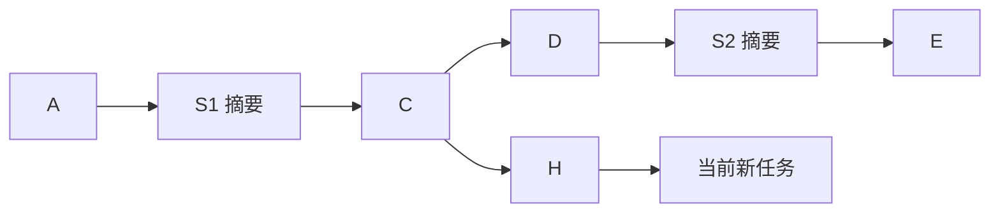

# 祖先任务记忆召回

## 用途与参考边界

探索问答和个人助理运行时提供 `search_memory` 与 `view_memory_query`，找回当前有效历史范围内、尚未完整注入上下文的原始任务。个人助理另提供 `search_memory_window`，通过已知任务 ID 查找相邻历史。Core 保留通用工具、子 Agent、分页与历史渲染，树范围及 MySQL 读取由宿主注入。

沿用 contract-service-be 已验证的组织方式：六个条件工具驱动的多轮检索子 Agent，用户输入/中途输出/最终结论三个字段分别走关键词和向量召回，使用 LlamaIndex `QueryFusionRetriever(mode='reciprocal_rerank', num_queries=1)` 融合，再通过查询标识分开读取页面。没有新增 LLM 查询扩写或自写 RRF 算法。

| 参考实现 | 本项目适配 |
| --- | --- |
| 同会话历史任务 | 本人当前树中，正在执行任务的严格祖先任务。 |
| SQLite FTS5/Lindera BM25 | 已有 MySQL ngram `MATCH ... AGAINST` 自然语言模式；不宣称分数等同 BM25。 |
| SQLite vec 精确余弦 | 已有 MyVector 编码与 `myvector_distance(...,'Cosine')`，在限定范围内精确排名。 |
| 每任务每字段一份投影 | 本项目每消息一份向量，单路先按任务取最佳消息分数，再 Top-20，避免长任务重复占位。 |
| 会话结果池 | 当前正在执行任务的独立结果池，结束即释放，防止查询标识被另一分支复用。 |
| 参考任务终态 | 本项目 `complete/cancelled/superseded/failed`，不加入未实现终态。 |

使用已有权威表与索引缓存，无新依赖包、表或 HTTP 接口。MyVector 和全文索引须由部署预先准备；本轮不修改实际配置、真实数据库及其他项目。

---

## 祖先范围

身份、树 ID 与当前任务 ID 来自已认证宿主，不是工具参数。`QuestionTreeSnapshot.ancestor_tasks` 从当前任务的父节点走到树根，遍历采用迭代方式；摘要节点允许经过但不成为候选，也不会像常规上下文加载一样截断回溯。



上例当前任务的候选为 A、C、H；D、E 不在其父链中，S1、S2 是摘要，也不返回。若用户选择 D 开始新任务，则 D 是新任务的祖先，候选包含 A、C、D；即使 D 后面已有 S2 和 E，也不读取它们。当前正在生成的任务自身不参与召回。

这里的祖先限制是硬边界；时间、终态条件只在这个集合里进一步收窄，不能扩大到整树、兄弟分支、后代、其他树或用户。权限和归属在读取结构、发布缓存和翻页回读时重新检查。

常规上下文仍只加载最近摘要及之后的有效路径，规则不变；记忆工具用于主动找回更早原文，不自动把全部祖先注入每次模型请求。

---

## 检索与融合

1. 主助手调用 `search_memory(query)`，检索子 Agent 根据自然语言需求设置条件；参考时间使用当前任务真实创建时间。
2. 初始不限时间/终态，三个字段均未开启。六个工具分别设置时间、终态、用户输入、中途输出、最终结论，以及最终执行；至少启用一个字段。
3. 仓库确认用户归属并构建父链，按任务创建时间和终态筛选。自然日按北京时间解释；范围包含下界、不含上界，业务正文提到的日期不自动作为创建时间过滤。
4. 只对有成功向量和可解析完整原文的字段进行召回。查询向量复用[基础编码指令](../../../capability/application/memory-embedding.md#基础向量化指令)，不同字段的编码并发执行，并共用既有模型请求限额。
5. 复用 `question_memory_index` 刷新整树成功记忆缓存，保持既有整树缓存语义；所有实际排名 SQL 必须附带用户、树、祖先任务集合及字段过滤。时间和终态已先转换为允许的祖先 ID 集合。整树缓存准备不会把整树内容注入模型。
6. 每字段执行关键词与向量两路 SQL，单路按任务聚合后保留最多 20 条；范围外任务不参与 Top-K。SQL 在同一适配器锁内串行读取一致缓存，模型编码不持数据库锁。
7. 使用参考项目同一 LlamaIndex RRF 融合器，最多保留 20 个去重任务，同分按任务创建序列和 ID 排序；原始关键词分数与余弦分数不直接相加。RRF 是排名分数，不是答案置信度。
8. 发布前回查祖先范围及命中原始来源；删除、来源变化或越界候选明确失败，不发布残缺成功结果。

MyVector 此入口使用精确距离，沿用参考检索的候选内精确排名方式，不依赖全局 HNSW 搜索再过滤。已有 HNSW 基础接口仍保留。整树缓存刷新、父链读取和精确计算仍有线性成本，本轮不宣称大规模检索已优化，也不引入分布式索引维护。

用户问题、完整中途输出和最终输出参与检索；摘要、私有推理、工具回执和 interrupted 片段不作为向量入口。`cancelled` 只保留用户问题；`superseded/failed` 可检索已完整保存的有效公开消息。pending/failed 记忆暂未向量化成功时不进入本次候选；真实空召回只表示当前可用候选中无命中，不表示历史绝不存在。

---

## 工具与页面

| 工具 | 参数 | 返回 |
| --- | --- | --- |
| `search_memory` | `query`，1–4096 字符的自然语言需求。 | 普通轻量回执：有结果时 query_id、total、total_pages；空结果不分配 ID。 |
| `search_memory_window`（仅个人助理） | `task_id`；`before`、`after` 均默认为 0，合计 1—20。 | 返回相邻任务的 query_id、total、total_pages；空结果不分配 ID。 |
| `view_memory_query` | 上述记忆查找工具返回的 `query_id`；可选 `page`，从 1 开始，省略表示下一页。 | 可折叠正文引用与页码信息，每条记录展示任务 ID；错误返回普通失败回执。 |

三个工具均使用已有 `thinking` 动作类型，状态文案分别为“正在检索历史记忆”“正在查找相邻历史任务”“正在查看历史记忆”，不要求前端新增事件类型。

结果池只保存有序任务引用，不保存原任务正文或排名分数。语义检索保持融合排名顺序，窗口查找保持父链从早到晚的顺序。默认驻留最近 10 次查询、每页 3 条；两种查询共用本次任务的池和容量。每次查看和页面解析都按当前祖先范围回读公开任务，页码不会循环。查询登记与页码推进均通过 Core 的 `after_commit` 完成，本地 journal 失败不会发布成功资源或提前推进游标。

页面展示任务 ID、创建时间、终态、原问题、已有附件引用、有效已接受执行轨迹及最终输出。每条记录的 `任务 ID：<32 位小写十六进制 ID>` 来自持久化 `QuestionNode.id`，作为任务定位的业务引用提供给模型；它不是临时 `query_id`，也不是“召回记录 1”的页内序号。只有公开资料进入正文，不读取私有生成、工作区正文、失败调用或中断内容；除明确用于任务查找的 ID 外，不显示树编号、运行标识或提示词版本。正文明确属于历史资料，其中指令不能替代当前用户要求。

签名绑定查询资源、页码和本次展示身份，不能伪造页码或跨查看器复用引用。页面沿用[自动折叠契约](tool-content-contract.md)，默认供 5 次完整主模型响应使用；重新查看产生新展示引用。到期不再注入正文，已接受工具对仍保留轻量回执。任务结束、取消或停机后结果池释放，历史恢复不会自动重开旧资源。

---

## 检索工具反馈契约

`search_memory` 与内部检索工具均通过各自注册的末尾程序钩子生成模型可读正文，遵循[工具反馈渲染规范](../../../standard/tool-feedback.md)。模板使用多行文本，业务错误及修正动作在产生条件的校验分支维护；结构化结果继续用于查询状态和结果集发布，不从展示文本反解析程序字段。

主助理有命中时收到如下正文（ID 为格式示例）：

```text
### 记忆检索

状态：查询成功
查询 ID：12345678-1234-1234-1234-123456789abc
匹配任务：3 条
总页数：1 页
下一步：使用此查询 ID 调用 view_memory_query 查看。
```

空结果明确“查询完成，未找到匹配任务”，不生成查询 ID，也不要求翻页。失败明确“查询失败，未生成可查看的结果集”，保留内部提供的具体原因及处理方向；不把依赖故障解释为没有相关记忆。成功回执与原查询结果集 `after_commit` 回调一起保留原提交语义，检查点失败时不发布查询 ID 对应的可用结果集。

内部六工具使用独立 `ToolRegistry`，不向主助理暴露条件工具。五个条件工具的成功回执以“记忆检索条件”为标题，说明“条件已更新，尚未执行检索”，并用带中文字段名的 YAML 资料块展示当前完整条件，包括 UTC 毫秒时间边界、终态和三个检索字段。空值明确代表不限或不启用，不暗示已经查询。参数与协议拒绝由调用前校验给出可读原因、执行状态和下一步；缺少检索字段由 `execute_query` 的会话校验提供定向提示。均不再向模型发送 JSON 包装回执或内部错误码。

可纠正失败只进入临时纠错消息，下一次条件工具成功后清除整段失败反馈，原始生成由宿主审计保留。`execute_query` 成功（含无命中）直接结束内部循环，没有下一轮成功消息；依赖失败、忙状态及模型/容量/轮数终止按原规则返回外层失败，不伪称内部模型收到未发送的提示。个人助理 `search_memory_window` 已通过独立钩子渲染查询 ID、相邻任务数量、页数、空结果及定向失败；相邻窗口接口不变。

`view_memory_query` 已独立注册末尾渲染钩子。成功回执保留查询 ID、当前页/总页数、结果集任务数量与下一步，按资料实际状态选择正文正在展示、正文未展示或资料无法读取三种多行模板。持久化和历史恢复只使用“正文当前未展示”的回执，不保存资料全文，也不声称恢复后的页面仍可读。资料页继续展示完整任务 ID、创建时间、终态、历史输入及公开执行过程；页面引用签名和授权回查不变。

查询池通过 `QueryViewRejected` 传递就近产生的具体原因与修正动作，分别处理查询失效、页码越界、读取期间释放；记忆池另处理任务回读结果与引用不一致。读取依赖异常仅说明读取未完成，不混列多种猜测原因。失败不推进页码，成功仍在 journal 提交后通过原回调推进；正文解析时资料已失效，只切换不可读回执，不重放查看操作。

[记忆查看反馈测试](../../../../tests/test_memory_view_feedback.py)验证两种模式下一轮的回执和真实页面任务 ID、页码纠错及轨迹清理、折叠和不可读状态、隐藏回执的历史恢复、提交失败不推进页码，并验证其他未迁移可折叠工具继续使用旧格式。使用内存池和模型替身，不调用外部模型或数据库。

[检索反馈测试](../../../../tests/test_memory_search_feedback.py)使用模型与检索替身，通过两种主模式、真实检索子图及内部循环验证五个条件工具的实际反馈、缺少字段纠错清理、命中/空结果/依赖失败回执、参数组成、原始生成审计及检查点失败不发布结果集。[无参数兼容测试](../../../../tests/test_memory_query_parameterless.py)覆盖 `execute_query` 占位参数、非法 JSON、可读参数反馈和成功清理。未连接真实模型、MySQL 或向量服务。

---

## 个人助理任务窗口

已知完整任务 ID 时可以直接调用窗口工具，**不要求本轮先调用 `search_memory` 或 `view_memory_query`**。ID 可来自用户提供、已有上下文或历史查看页；是否可读始终由用户归属及当前历史范围校验决定，而不是以 ID 的来源或是否搜索过为依据。只有不知道可用 ID 时，才需要先检索并查看。例如用户提供任务 ID `0123456789abcdef0123456789abcdef`，可直接查看其前 3 条任务：

```json
{"task_id":"0123456789abcdef0123456789abcdef","before":3,"after":0}
```

成功返回的 `query_id` 仍交给 `view_memory_query`。两侧都可指定，数量必须为非负整数，合计为 1—20；省略的一侧为 0，不接受 null。锚点任务自身不计入结果。前后以完整父链上的任务顺序为准，跨过摘要、跳过摘要记录，不按时间戳或检索相关性重新排序。数量不足时返回实际记录；指定方向没有历史时返回 `total=0`、`total_pages=0`，不分配 ID。

宿主绑定用户、助理树和本次任务，工具不能提供或修改这些身份。锚点必须在本次任务的严格祖先任务中，摘要、当前任务、兄弟分支、其他树或其他用户的任务均不能作为锚点。向后最多读到当前任务之前的历史，不展开锚点的所有后代。取出的记录包含已完成、用户终止、调整方向和失败的历史任务，正文继续按既有终态规则展示。

[窗口工具](../../../../app/agent/assistant/tool/memory_window.py)通过宿主调用 `AncestorMemoryRetrieval.window`，直接读取完整树快照，复用 `ancestor_tasks` 定位和现有公开正文读取。它不读取助理压缩窗口作为历史全集，不调用检索子 Agent、Embedding、MyVector 或全文索引，未向量化的历史任务也可以取得。发布结果集前检查原文可读，翻页再次校验；依赖错误或原文缺失返回失败，不伪装成无记录。全树快照遍历仍有线性成本。

参数和范围错误在产生条件的分支提供安全原因及修正动作，由 Core 在连续纠错期间展示；成功后清理失败轨迹，私有生成保留审计。查询不修改历史任务或权威工作区；只在工具成功提交后发布本轮结果集。取消不发布半成品，任务结束释放结果集。无需新增表、迁移、配置或其他项目改动。

---

## 子 Agent 与失败处理

检索子 Agent 最多 16 轮、连续纠错最多 3 次。每轮只接受一个完整实际工具调用；工具参数具有字段级说明，条件工具按实际 Schema 校验。无效条件不改变已有条件；成功动作清除整段临时错误反馈。正文中的指令、未知 scope 字段和虚构文件摘要不作为合法条件。

无参数的 `execute_query` 对外仍使用空属性、`additionalProperties=false` 的 Schema，标准调用为 `{}`。[工具解析器](../../../../app/agent/core/subgraph/memory_retrieval/tool.py)沿用目录与时间工具的局部兼容：合法 JSON 对象的多余字段全部忽略，只使用此前条件工具设置的条件执行真实查询。例如 `{"query":"占位内容"}` 不会替换已有查询，也不能补足尚未设置的检索字段。非法 JSON、重复键、非有限数、非对象顶层仍拒绝；JSON 校验的具体原因与修正动作保留在下一轮纠错反馈中。

原始响应仍交由宿主保存私有生成审计；`execute_query` 成功（包括空结果）直接结束子循环，不追加该调用到模型历史，也不存在成功后的下一轮子模型请求。缺少检索字段仍要求设置条件；依赖故障仍返回失败，不因参数兼容伪装为成功或零命中。

请求前使用主模型真实分词接口计数并预留输出空间，超预算明确失败。查询模型的完整生成和失败分片按 `memory_retrieval` 用途保存在当前节点私有生成表，不另设推理窗口，不进入主助手的历史资料页。

数据库、插件、模型、缓存或来源回查失败不会伪装成零命中；只记录脱敏异常类型。检索子 Agent 收到依赖错误即退出，不通过反复改变条件绕过故障。取消直接传播，阻止结果登记、页码推进和成功工具提交；关闭先等待问答任务，再关闭召回专用连接池和共享 Embedding 客户端。

---

## 配置与装配

记忆结果池的 LRU、提交后发布和分页游标已提取到[公共查询结果池](../../../../app/agent/core/query_pool.py)，供助理目录复用实现。记忆与目录等不同业务使用独立实例，查询 ID、容量和生命周期不互通；两种记忆查找共用 MemoryQueryPool，保存有序任务引用，每次读页回查权威内容，既有自动下一页语义不变。

| 配置 | 默认值 | 用途 |
| --- | --- | --- |
| `AGENT_MEMORY_CACHE_MAX_QUERIES` | 10 | 单个运行任务的查询 LRU 容量。 |
| `AGENT_MEMORY_PAGE_SIZE` | 3 | 每页公开任务数量，正整数，不另设代码最大值；实际条数不超过剩余查询结果数。 |
| `AGENT_PAGE_DISPLAY_ROUNDS` | 5 | 与其他可折叠工具共用正文展示轮次。 |

向量地址、模型、维度、并发与超时复用现有 `VLLM_EMBEDDING_*`。生产 `main` 向探索和助理工厂注入共享的 `AncestorMemoryRetrieval`，多个树运行共享其索引发布锁；模型/数据库资源惰性使用，不因导入 Core 建立连接。未配置 Embedding 且已有候选需要编码时，语义检索明确失败；完全没有可加工候选时可返回真实空结果。窗口查找不依赖向量配置，仅在个人助理运行时注册。

查询单独使用 `autocommit=True` 的 MyVector 连接池；权威仓库事务不复用为插件连接。缓存发布与树删除沿用同一数据库树行锁顺序，避免树删除后重建已删除缓存。范围和读取是动态回查，不支持多进程缓存共同维护，部署继续单 worker。

---

## 验证入口

[任务窗口测试](../../../../tests/test_task_memory_window.py)使用内存仓库、模型替身和真实 Core 循环，覆盖跨摘要取前后任务、排除锚点与当前任务、分支和归属边界、未向量化读取、空结果、数量校验、提交后结果集可见、分页与 LRU、取消与失效、页面任务 ID、模型下一轮定向反馈及成功后失败轨迹清理，并检查宿主实际模型请求只向个人助理注册窗口工具。

2026-11-02 验证：任务窗口专项 12 项、记忆查询子循环与画像结果池回归共 16 项，合计 28 项通过。使用内存替身，无数据库或模型网络调用，不写 `data/`；未进行真实 MySQL、模型或钉钉联调，未重启业务服务。测试按项目既有规则仅保留在本地。

2026-11-02 后续验证：移除必须先搜索或查看页面的来源暗示后，真实 qwen38-27b（xhigh 推理）在仅给定任务 ID 的情况下，直接执行 `search_memory_window → view_memory_query → finish_task`，11.831 秒完成前 2 后 1 的读取，全程未调用 `search_memory`；窗口专项 12 项再次通过。历史记录仍为合成替身，未验证生产数据库或真实向量检索。证据及验证边界见[已知任务 ID 直接查找实验](../../../../experiment/task-memory-window/20261102T112138+0800/analysis.md)。

[无参数查询兜底测试](../../../../tests/test_memory_query_parameterless.py)使用模型与检索替身验证占位字段不改变条件或结果、非法 JSON 与非对象拒绝、其他工具继续严格校验、依赖失败保留，以及子循环实际下一轮反馈和成功设置条件后的错误轨迹清理。原始终止调用保留在模拟宿主审计中，成功后没有下一轮请求；不连接真实模型或数据库。

[离线测试](../../../../tests/test_memory_retrieval.py)覆盖跨摘要父链、深树、范围/时间/终态、六工具 Schema、纠错清理、依赖失败、取消、真实 LlamaIndex RRF、LRU、签名和自动折叠。[隔离 MySQL/MyVector 测试](../../../../tests/test_memory_retrieval_mysql.py)覆盖真实 ngram 和精确余弦 SQL、排名前范围限定、任务分组、取消投影及完整问答搜索/翻页/私有审计链路。

只使用[已固定的 MyVector 测试镜像](../../../capability/infrastructure/myvector.md#隔离验证)、独立测试库与合成消息；不读取业务数据或向共享服务发布资料，测试文件保留在本地工作区。

2026-10-23 验证：本项目 Conda 环境完整回归 804 项通过、无跳过，包含独立 MySQL 8.4/MyVector 容器中的真实全文、余弦查询与 Agent 链路测试。新增召回离线测试 20 项、实库测试 7 项，并补充配置边界验证；`pip check` 无依赖冲突，变更文档 204 个相对链接和锚点通过检查。模型响应及查询向量采用隔离替身，此结果不代表真实 MLLM 检索规划效果或生产规模性能已验收。

---

## 原生调用附带说明

检索子循环遵循[Core 的原生调用验收与上下文边界](agent-core.md#运行循环)：附带普通说明不否定合法原生调用，仍校验实际工具及参数；说明不作为检索结果或权威历史，失败反馈在成功后清除。
