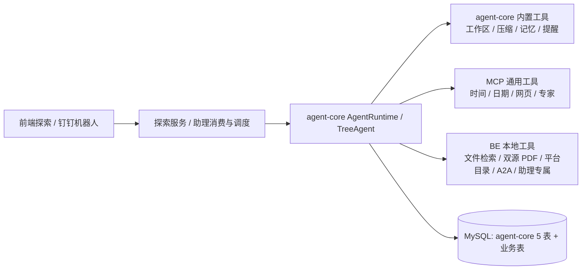

# 智能体问答工作流总览

## 任务目标与架构

本工作流包覆盖**探索模式（Exploration）**与**个人助理（Assistant）**两大问答场景。二者统一运行在外部 [Agent Core 运行时](../../../capability/application/agent-core-library.md) 之上，共用 `agent-core` 提供的多轮工具循环、上下文预算与压缩、工作区持久化及祖先记忆检索，并通过 [MCP Server](../../../capability/infrastructure/mcp-server.md) 复用通用外部工具与文件转 PDF 能力。

---

## 包内文档导航

### 模式与会话

- [问答模式与装配](agent-modes.md)：探索模式与个人助理的运行策略、工具清单与提示词组织。
- [探索会话与 SSE](exploration-session.md)：先注册后订阅激活、主干 `main_leaf_id` 与历史节点持久化分叉、取消/改向与断线重连。
- [公司背景与默认指代](company-background.md)：现象创新公开业务背景与默认指代规则。

### 共享本地工具与契约

- [工具内容与反馈契约](tool-content-contract.md)：`agent-core` `RegisteredTool`、`FoldableToolContent`、`FeedbackOnlyHook` 契约与全量工具清单。
- [工具失败分层处理](tool-failures.md)：`correctable`、`failed`、`dependency`、`unknown` 与 `ToolOperationFailed` 边界。
- [注册中心文件检索](file-retrieval.md)：`RegistryFileSearchBackend` 与 `search_files` / `view_file_candidates` 适配。
- [双源 PDF 逐页查看](registry-file-reading.md)：统一的 `view_pdf` 工具（本地上传附件 + 注册中心远程 PDF + 助理公开门禁）。
- [子管理平台目录](sub-management-platform.md)：`list_sub_management_platforms` 可折叠目录查看。
- [跨平台 A2A 协作](platform-a2a.md)：`broadcast_platform_a2a` 与 `continue_platform_a2a`。

### 个人助理专属专题

- [个人助理上下文与记忆窗口](assistant-memory.md)
- [个人助理个人信息与画像](assistant-personal-context.md)
- [个人助理最终正文转换](assistant-message-rendering.md)
- [文件内容告知检查](file-disclosure.md)

---

## 关联能力与规范

- [Agent Core 运行时接入](../../../capability/application/agent-core-library.md)
- [MCP Server 接入与通用工具封装](../../../capability/infrastructure/mcp-server.md)
- [附件统一转 PDF](../../../capability/application/attachment-conversion.md)
- [vLLM 模型接入配置](../../../capability/infrastructure/vllm-models.md)
- [工具反馈渲染规范](../../../standard/tool-feedback.md)
- [提示词工程规范](../../../standard/prompt-engineering.md)
- [多轮 Agent 上下文与记忆管理规范](../../../standard/agent-context-management.md)
