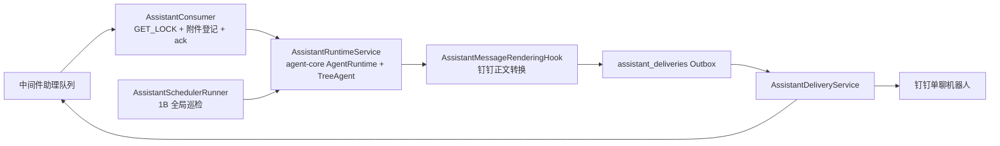

# 助理消费、运行时与可靠交付

本文档说明个人助理如何通过中间件队列消费用户与跨助理消息、经 `agent-core` 执行任务并可靠交付到钉钉与目标助理。

---

## 1. 整体架构

---

## 2. 核心组件与职责

1. **`AssistantRuntimeService`（`app/service/assistant_runtime.py`）**：
   - 基于 `agent_core.AgentRuntime` 与 `Models(VLLMClient, VLLMEmbedding, vllm_counter)`，按用户 `tree_id` 驻留 `TreeAgent(execution_mode='queue', workspace_retention='latest', persist_new_nodes=True)`。
   - 通过 `build_assistant_tools` 装配全量 38 个模型可见工具：9 个 `agent-core` 内置工具（工作区、压缩、记忆检索、1B 提醒）、22 个本地助理工具（含定制 `finish_task`、`send_assistant_message`、画像/备忘/可见性/日程/文件检索/双源 `view_pdf` 等）以及 7 个 MCP 工具。
   - 统一注入 `AssistantMessageRenderingHook` 与 `on_final_deliver` 回调，使中间件任务与 1B 本地提醒/心跳共用同一套 Outbox 交付。
2. **`AssistantConsumer`（`app/service/assistant_consumer.py`）**：
   - 周期扫描在职员工，受 `max_concurrent_users` 信号量限制；按 `MySQLRepositoryBase.user_scope(userid)` 持跨实例 MySQL `GET_LOCK` 串行消费。
   - 每次消费先恢复 `awaiting_ack` 中未确认的终态任务，再通过 `AssistantQueueService.execute_once` 领取租约、下载并校验附件（登记至 `uploaded_files` 与 `assistant_tree_files`）、拼装员工档案与来源说明到 `supplemental`，调用 `AssistantRuntimeService.run_task(..., external_id=record.task_id)` 执行。
   - 任务成功后刷新 `AssistantDeliveryService.flush(record.task_id)` 并确认队列 `ack`；任务异常标记 `failed` 后释放队列，避免毒丸任务永久阻塞。
3. **跨助理消息与可靠交付（`app/service/assistant_delivery.py`、`app/service/assistant_file_delivery.py`）**：
   - `send_assistant_message` 在工具 `execute` 期凭 `current_tool_call_id` 幂等写入 `assistant_deliveries(destination='assistant')`，`after_commit` 触发 `flush` 发布至中间件队列。
   - 发往钉钉用户前先标记 `delivery_unknown`，再核对员工在职状态与附件归属（`AssistantFileDeliveryService` 经 `MySQLAssistantRepository.find_file` + `UploadedFileRepository.get_owned` + `UploadFileStore` 双次校验），防止离职通知或越权附件发送。

---

## 3. 启动开关与验证状态

- 由环境变量 `ASSISTANT_ENABLED=true` 显式开启（默认 `false`），启用时要求同时启用中间件会话与钉钉机器人凭据。
- 验证状态：已通过 `tests/assistant_v2/test_assistant_e2e.py` 与 `tests/assistant_v2/test_assistant_tools.py` 自动化验证（SQLite + Fake ChatProvider/Embedding + Mock DingTalk）；尚未执行真实钉钉单聊端到端收发验收。
